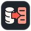

<!-- MAINTAINER:README_HEAD:START -->
<div id="maintainer-title" align="center">
    
    <h1>Dapter</h1>
</div>

<p id="maintainer-badges" align="center">
<a href="https://atb.dev.br/docs/dapter"></a>
<a href="https://atb.dev.br/docs/dapter#requirements"></a>
<a href="https://atb.dev.br/docs/dapter#requirements"></a>
<a href="https://github.com/artisan-toolbox/dapter/actions/workflows/tests.yml?query=branch%3A1.x"></a>
<a href="https://atb.dev.br/docs/dapter"></a>
</p>

<p id="maintainer-description" align="center">
    Headless data listings for Laravel and Vue.
</p>
<!-- MAINTAINER:README_HEAD:END -->

Dapter connects Laravel data sources to headless Vue listings. Add search, filters, sorting, pagination, and authorized actions to your own presentation. This is an unpublished local preview.

## Installation

For the local preview, place this checkout beside your Laravel application. From the application root, run:

```bash
composer config repositories.dapter path ../dapter
composer require artisan-toolbox/dapter:"1.x-dev@dev"
npm pkg set 'dependencies.@artisan-toolbox/dapter=file:vendor/artisan-toolbox/dapter'
npm install --install-links
```

## Usage

Complete the [installation guide](https://atb.dev.br/docs/dapter/installation), then create `app/DataSources/Products.php`:

```php
namespace App\DataSources;

use ArtisanToolbox\Dapter\Attributes\PublicAccess;
use ArtisanToolbox\Dapter\CollectionDataSource;

#[PublicAccess]
final class Products extends CollectionDataSource
{
    /** @return list<array{name: string}> */
    public function source(): array
    {
        return [['name' => 'Notebook'], ['name' => 'Pencil']];
    }
}
```

Expose the package route `dapter.data` through Ziggy, keep Laravel's web session and CSRF integration, and render the source in an existing Inertia page:

```vue
<script setup>
import { DataAdapter } from '@artisan-toolbox/dapter';
</script>

<template>
    <DataAdapter source="Products" v-slot="adapter">
        <p v-if="adapter.paging.loading">Loading...</p>
        <p v-if="adapter.error" role="alert">{{ adapter.error.message }}</p>
        <ul v-if="adapter.ready">
            <li v-for="(product, index) in adapter.data" :key="index">
                {{ product.name }}
            </li>
        </ul>
    </DataAdapter>
</template>
```

After loading, the list displays Notebook and Pencil. The public attribute is explicit for this fictional catalog; authentication is required by default. Run the [functional examples](https://atb.dev.br/docs/dapter/listing) for paging, configuration, and access behavior.

## Compatibility

PHP ^8.5, Laravel ^13.0, Inertia Laravel ^3.0, Inertia Vue and Core ^3.0.3, Vue ^3.5.40, Ziggy ^2.6.5, and Node.js >=24.11.0 for frontend tooling. The source entry needs Vue-aware Vite and TypeScript tooling, plus `optimizeDeps.exclude` for `@artisan-toolbox/dapter` during development. Follow the [installation guide](https://atb.dev.br/docs/dapter/installation) for the consuming application's Vite configuration. Set `protocol: 2` for declared field controls. Follow the [feature guides](https://atb.dev.br/docs/dapter) for other opt-ins. The preview uses `1.x` and has no stable release.

## Documentation and policies

- [Documentation](https://atb.dev.br/docs/dapter)
- [Contributing](https://atb.dev.br/docs/dapter/development)
- [Security policy](.github/SECURITY.md)
- [Changelog](CHANGELOG.md)
- [License](LICENSE.md)
